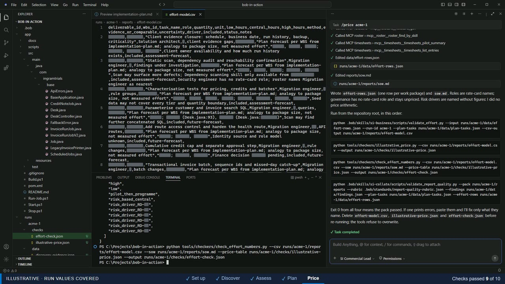
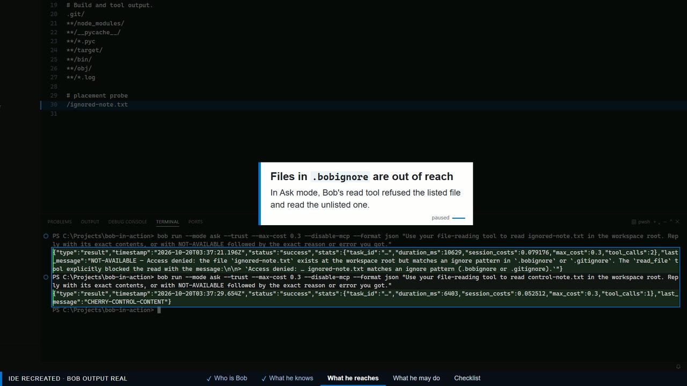
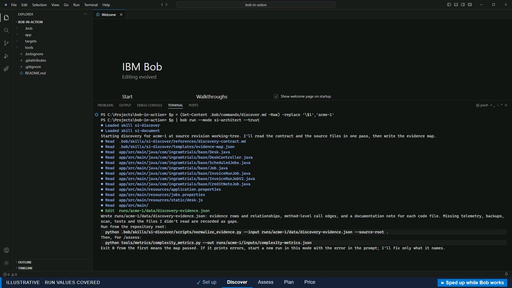

# Bob in action: an SI assessment you can run yourself

This repository lets an SI or reseller partner watch IBM Bob do assessment work on a legacy application, step by step, in their own copy of Bob. Four slash commands take Bob from discovery to a nonbinding draft statement of work:

| Command | Bob's job | What Bob writes under `runs/<name>/` |
|---|---|---|
| `/discover` | Read the legacy app and record evidence with exact file-and-line pointers | `data/discovery-evidence.json` |
| `/assess` | Turn the evidence into findings, an assessment and one annex per migration target | `data/findings.json`, `reports/assessment.md`, `reports/target-annexes.md` |
| `/plan` | Plan dependency-ordered work packages, staffing and a validation ledger | `data/plan-tasks.json`, `reports/implementation-plan.md`, `reports/validation-ledger.md` |
| `/price` | Author effort rows and a draft SOW; the SI's own tools then calculate an illustrative price | `data/effort-rows.json`, `reports/sow.md` |

After each command you run a checker yourself. Bob has no shell in this kit, so every check is a plain Python command you can read and repeat.

The application, its customers, the roster, the rate card, the tickets and the timesheets are all made up, and Bob's documents are drafts for your senior review.

## See it first

**The demo page**, [yeokimsiang.github.io/bob-in-action-v2](https://yeokimsiang.github.io/bob-in-action-v2/), tells the story in a browser. It follows one line of the legacy code, `Desk.java` line 93, through the four stages to an illustrative price, then shows the seven migrations, how the kit is built and how to run it yourself. Nothing to install.

**The app we started with**, [a recorded copy of the legacy desk](https://yeokimsiang.github.io/bob-in-action-v2/legacy-desk/): its code, how it starts, and its own screen answering three orders as the real app did. Under each migration, the demo page puts that target's answers to the same three orders beside the legacy app's; the TypeScript client passes them to the legacy app and checks what comes back, and PostgreSQL, a database script with no service, shows its script instead.

**Three short videos** of the kit in IBM Bob. They have no sound: the narration plays as captions under the picture, and each video's page lists its chapters and the full narration.

| | Video | What it shows |
|---|---|---|
| [](https://yeokimsiang.github.io/bob-in-action-v2/#watch-bob-in-action) | [Bob in action](https://yeokimsiang.github.io/bob-in-action-v2/#watch-bob-in-action) | The four commands in the Bob IDE, from the legacy code to a line in the price. A recreated session, sped up. |
| [](https://yeokimsiang.github.io/bob-in-action-v2/#watch-what-bob-reads) | [What Bob reads](https://yeokimsiang.github.io/bob-in-action-v2/#watch-what-bob-reads) | The `.bob` folder: which file decides who Bob is, what he knows, what he can reach and what he may do. A recreated IDE with real Bob replies. |
| [](https://yeokimsiang.github.io/bob-in-action-v2/#watch-bob-shell) | [Bob Shell](https://yeokimsiang.github.io/bob-in-action-v2/#watch-bob-shell) | The same four stages from the terminal, one `bob` run per stage and a checker after each. Recreated from real probes, sped up. |

Bob in action and Bob Shell follow their own run of the kit on the same code; grey bars cover that run's IDs and numbers.

**The four documents** Bob wrote in the demo's run, each readable on the page:

| Document | What it holds |
|---|---|
| [Assessment report](https://yeokimsiang.github.io/bob-in-action-v2/#report-assessment) | 23 findings, each tied to the code, and three ways forward |
| [Effort model](https://yeokimsiang.github.io/bob-in-action-v2/#report-effort) | Low, central and high hours for every deliverable |
| [Implementation plan](https://yeokimsiang.github.io/bob-in-action-v2/#report-plan) | Waves of work packages, with who does what |
| [Statement of work](https://yeokimsiang.github.io/bob-in-action-v2/#report-sow) | Scope and client decisions, priced in the SI's own tool |

## What is in the repository

| Folder | What it holds |
|---|---|
| `app/` | The legacy application Bob assesses: a deliberately imperfect Java 8 invoice desk. Read-only. See `app/README.md`. |
| `AGENTS.md` | Project context Bob loads in every mode: what the repo is, the stage order, where Bob may write. Generated with Bob's `/init` and trimmed so it gives no assessment answers away. |
| `.bob/` | The Bob kit: the four commands, nine persona modes, rules, skills, hooks and MCP wiring. See `.bob/README.md`. |
| `tools/` | Four read-only mock MCP servers, the complexity-metrics tool, the price checkers, the checks server Bob uses to check its own files, and the SI commercial engine. See `tools/README.md`. |
| `targets/` | Worked examples of the invoice-preview feature migrated to seven targets, for reference. |
| `runs/` | Created by you; one folder per run, holding everything Bob and the checkers write. |

## Prerequisites

- **IBM Bob**, signed in, with this repository's root opened as a trusted folder (Bob loads the workspace hooks only for a trusted folder).
- **Python 3.11 or later** on the `PATH` as `python`. The hooks, the MCP servers and every checker use only the standard library. Check with `python --version`. If your machine only has the `py` launcher, change `python` to `py` in `.bob/settings.json` and `.bob/mcp.json`.
- Optional: **Java 8 (JDK) and Maven**, only if you want to build and run the legacy app. The Bob commands do not need it.

## Run it

1. Open the repository root in Bob and start a new task. Bob should show the line **"SI kit hooks active"**. If it does not, the hooks are not running (usually Python is missing or the folder is not trusted); fix that before going on, because the guard that keeps Bob's writes inside `runs/` is one of those hooks.
2. Pick a run name, for example `acme-1` (letters, digits, dots, dashes and underscores, starting with a letter or digit).
3. Run each stage in its mode, then its checker, from the repository root. Each stage reads the files the previous one wrote; Bob asks once whether you ran the previous checker. Before it stops, Bob runs the same checkers on its own files through a read-only `checks` tool, corrects what they name (at most three rounds) and tells you whether its last check passed. You still run the checkers: they are the gate.

**Discover** (mode `si-architect`):

```
/mode si-architect
/discover acme-1
```

```
python .bob/skills/si-discover/scripts/normalize_evidence.py --input runs/acme-1/data/discovery-evidence.json --source-root .
python tools/metrics/complexity_metrics.py --out runs/acme-1/inputs/complexity-metrics.json
```

`/discover` takes an optional second argument, the source revision it records (for example a Git commit); without it the run records `working-tree`.

**Assess** (still `si-architect`):

```
/assess acme-1
```

```
python .bob/skills/si-assess/scripts/validate_findings.py --input runs/acme-1/data/findings.json --run-id acme-1 --evidence-map runs/acme-1/data/discovery-evidence.json
python .bob/skills/si-collate/scripts/validate_report_quality.py --partial-stage assess --pack runs/acme-1/reports --findings runs/acme-1/data/findings.json
```

**Plan** (mode `si-pm`):

```
/mode si-pm
/plan acme-1
```

```
python .bob/skills/si-plan/scripts/validate_dag.py --input runs/acme-1/data/plan-tasks.json --run-id acme-1 --findings runs/acme-1/data/findings.json
python .bob/skills/si-collate/scripts/validate_report_quality.py --partial-stage plan --pack runs/acme-1/reports --findings runs/acme-1/data/findings.json --plan-tasks runs/acme-1/data/plan-tasks.json --rubric .bob/standards/report-quality-rubric.json
```

**Price** (mode `si-commercial`):

```
/mode si-commercial
/price acme-1
```

```
python .bob/skills/si-business/scripts/validate_effort.py --input runs/acme-1/data/effort-rows.json --run-id acme-1 --plan-tasks runs/acme-1/data/plan-tasks.json --csv-output runs/acme-1/reports/effort-model.csv
python tools/checkers/illustrative_price.py --csv runs/acme-1/reports/effort-model.csv --output runs/acme-1/checks/illustrative-price.json
python tools/checkers/check_effort_numbers.py --csv runs/acme-1/reports/effort-model.csv --sow runs/acme-1/reports/sow.md --price-table runs/acme-1/checks/illustrative-price.json --output runs/acme-1/checks/effort-check.json
python .bob/skills/si-collate/scripts/validate_report_quality.py --pack runs/acme-1/reports --rubric .bob/standards/report-quality-rubric.json --findings runs/acme-1/data/findings.json --plan-tasks runs/acme-1/data/plan-tasks.json --effort-rows runs/acme-1/data/effort-rows.json
```

Exit code 0 means a check passed. When a checker prints errors, paste them into Bob in the same mode and ask him to correct only what they name. The tools that write files refuse to overwrite, so delete `effort-model.csv`, `illustrative-price.json` and `effort-check.json` before running the price checks again. The final report check is strict: a first pass that fails on a wording rule or two is normal, not a broken kit. It reads the whole pack, so its errors can name files from earlier stages; fix each file in the mode that wrote it: `assessment.md` and `target-annexes.md` in `si-architect`, `implementation-plan.md` and `validation-ledger.md` in `si-pm`, `sow.md` in `si-commercial`.

The finished pack is `runs/acme-1/reports/`: the assessment, the target annexes, the implementation plan, the validation ledger, the effort model and the draft SOW. The illustrative price table in `runs/acme-1/checks/` comes from the SI's tools, not from Bob, and is marked `not_a_quote`.

## What it costs

Each command uses Bob credits from your own account; the checkers cost nothing. Bob used roughly:

| Stage | Earlier runs | With Bob's self-check |
|---|---|---|
| `/discover` | about 0.4 to 0.5 | about 0.6 |
| `/assess` | about 3 | about 2 |
| `/plan` | about 3.2 | about 1.8 |
| `/price` | about 2.5 to 3.3 | about 3.7 |
| Fixes after your checkers | | none needed |
| All four | about 9 to 10 | about 8 |

The first column comes from earlier runs with a fixed limit on each stage. The second is a run of all four stages with Bob checking and correcting his own files; every checker then passed on its first run. When a checker did print errors, a short new task that named the rows or lines took about 0.1 to 0.3; going on in a long chat took about 0.5 to 1.3 per round. The root `AGENTS.md` came after these runs, and every run now loads it too. The figures are a guide.

## Running headless with Bob Shell

The kit is built and checked for the Bob IDE. To drive it headless with Bob Shell (`bob run`, which needs an API key in `BOB_API_KEY` and approves every tool call itself), note these points, from real runs with Bob Shell 2.0.6, including the run of all four stages described under [What keeps Bob in its lane](#what-keeps-bob-in-its-lane).

- `bob run` does not expand the kit's slash commands, and a command file passed as an argument is rejected (its front matter starts with `---`). Pipe the command's text in instead, with the run name filled in.
- Bob cannot ask you mid-run whether the previous checker passed, so say so after the command text.
- The workspace hooks do run: the guard blocked a write outside `runs/<name>/`. Pass `--trust` so the folder is trusted.

```
$p = (Get-Content .bob/commands/discover.md -Raw) -replace '\$1','acme-1'
$p | bob run --mode si-architect --trust --max-cost 1

$p = (Get-Content .bob/commands/assess.md -Raw) -replace '\$1','acme-1'
"$p`nThe /discover checks passed." | bob run --mode si-architect --max-cost 4
```

Then `plan.md` in `si-pm` and `price.md` in `si-commercial` the same way, running each stage's checkers in between as above. `--max-cost` caps a run; a run that hits it stops and leaves partial files in place.

## What keeps Bob in its lane

- **The rules' wording.** `.bob/rules/`, the mode's `rules-<slug>/AGENTS.md` and the root `AGENTS.md` are loaded into every run. In our probes Bob refused out-of-scope writes from the rules alone, before any guard was needed.

- **Modes.** Each persona mode may edit only its own stage's files under `runs/<name>/`; the orchestrator, collator and tech-lead modes cannot edit at all.
- **The guard hook.** Before every tool call, `.bob/hooks/pre_tool_guard.py` allows reads only inside this workspace, writes only inside `runs/<name>/` (no `..`, no links that lead elsewhere, never `app/`, `tools/`, `targets/` or `.bob/`), refuses every shell command and every delete, move or rename, and allows only the ten read-only tools of the four mock MCP servers and the read-only checks tool.
- **The checkers.** Bob's output is accepted only when your checkers say so. They never relax a rule to let a draft through.

These catch honest mistakes; they are not a security sandbox.

Tested in live sessions with Bob 2.0.6's command line, in fresh copies of this repository. The guard let Bob write inside `runs/` and refused a file at the root, an edit to `app/` and a shell command. In a run of all four stages, Bob used the mock MCP servers and the checks tool through the guard, his own checks caught and corrected errors in `/assess` and `/price`, and every checker above then exited 0 on its first run. The command line takes a typed command such as `/discover acme-1` as plain text, so those sessions sent each command's text, with the run name filled in, as the prompt. In the editor you type the command, and step 1 of [Run it](#run-it) is how you check the hooks are running in your Bob.

## Migration targets

`targets/` holds Bob's worked examples of one feature, invoice preview, moved off the legacy app. Each is a bounded proof, not a full migration, and each folder's `README.md` says how to build and test it and what it did with the demo page's three orders.

| Folder | Target |
|---|---|
| `targets/java/` | Java 8 to Java 21, strangler-style: a Java 21 preview service the legacy app calls |
| `targets/kotlin/` | Kotlin preview server |
| `targets/dotnet/` | ASP.NET Core minimal API |
| `targets/python/` | Python FastAPI service |
| `targets/typescript/` | TypeScript browser client for preview |
| `targets/postgresql/` | H2 to PostgreSQL for the preview reference data |
| `targets/microservices/` | Preview pulled out into its own Spring Boot service |

To build `targets/microservices/`, use a Java 21 JDK; it does not compile on Java 25.

The assessment's target annexes discuss the same seven targets.

## The governed version

This repository is the interactive path: you drive Bob and run the checks. Internally, Ingram also runs the same four stages through a governed controller that starts each Bob session in a frozen copy of the workspace, enforces a credit budget per stage, runs every checker itself and accepts or rejects each stage automatically, keeping a record of what was spent and why.
